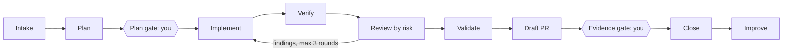

# jflow

An agentic development workflow for Claude Code: a task ledger (`jplan`), a pipeline (`/jflow`), safety hooks, agents, skills and the plugin sets they rely on. This repo is the source of truth; `~/.claude` holds an installed copy.

Runs on Windows, macOS and Linux. What you type and where you are asked is in [docs/usage.md](docs/usage.md). The idea, the build log and the improvement paths are in [docs/how-it-works.md](docs/how-it-works.md).

## Why

Mining five weeks of the owner's own Claude sessions (to 2026-11-11) gave three numbers. Each one became a part of the design.

| Finding | What it showed | The part that answers it |
|---|---|---|
| 65% of all weighted tokens sat in nine chat sessions older than a week | The task lived in the chat | The ledger: state in files, one task per session |
| "What's left?" was asked 17 times | Nobody, human or agent, knew the state | A status and a `next` line per task: `jplan ls` |
| 15 stray PR approvals from one prompt | Nothing stood between the agent and the outside | Gates in hooks and scripts, not in prompts |

## The idea

The agent writes the code. You decide twice: once at the plan, before anything is written, and once at the evidence, before anything is merged. Between those two points nothing depends on the agent remembering an instruction. Every gate is a hook or a script.

## How one task moves



| Stop | Ledger status | What happens |
|---|---|---|
| Intake | `todo` | The task gets a folder in the ledger |
| Plan | `active` | The planner reads the code and writes `plan.md` |
| **Plan gate** | `waiting` | The task does not move until you approve the plan |
| Implement, Verify, Review | `active` | Code in a worktree, the project's own build and tests, review at a depth that follows risk. Findings go back to Implement, three rounds at most |
| Validate, Draft PR | `active`, then `review` | A check on a running stack, then a draft PR |
| **Evidence gate** | `waiting` | You read the evidence before the PR leaves draft |
| Close, Improve | `done` | After merge the task closes. Improve reads the statistics across tasks and proposes one change to the workflow |

Every stop writes its state to the ledger (`task.json`, `plan.md`, `evidence/`, `handoff.md`), so a fresh session picks the task up from the files alone.

## Many tasks at once

One task is easy to hold in your head. In practice several run at once, each in its own thread, and each stops at a different gate. `jplan ls` lists every open task with its status and what it waits for.

The Mayor is an opt-in overseer for exactly this: a small program that the OS scheduler starts every 10 minutes, at zero tokens, to join GitHub, threads, sessions and the ledger into one board and an inbox. It is on trial on branch `trial/jmayor` and is not part of `main` until the trial has passed.

## Measured so far

- First task through `/jflow`: a CI run for a pull request went from 36 to 41 minutes down to 18m31s, with the same 8,163 tests.
- The ledger tool takes 25 ms per call, against 343 to 538 ms for the PowerShell script it replaced. That is cheap enough to update after every stage.

## New machine

1. Install Claude Code and sign in.
2. Install PowerShell 7 (`pwsh`). The installer and the hooks are PowerShell on every platform.
   - Windows: `winget install Microsoft.PowerShell`
   - macOS: `brew install powershell`
   - Linux: see https://learn.microsoft.com/powershell/scripting/install/installing-powershell-on-linux
3. Install `git` and `gh`, then `gh auth login`. Windows and macOS: the installer installs both when they are missing. Linux: install them with your package manager.
4. Clone and install:

```sh
gh repo clone jurgiskisunas-visma/jflow
pwsh -File jflow/install.ps1
```

5. Open a new terminal and restart Claude Code.
6. Do the steps under "Not automated".

`install.ps1` is safe to re-run. It adds the marketplaces and plugins from `plugins.json`, copies `claude/` into `~/.claude` (a differing file is backed up to `~/.claude/backups/` first), registers the hooks in `settings.json`, tests and builds `jplan` into `~/.claude/bin`, puts that folder on the PATH, seeds the planning root and runs the hook tests.

Go is needed only to build `jplan`, and the installer gets it: `winget` on Windows, Homebrew on macOS, and otherwise a private copy under `~/.claude/tools/go` (downloaded from go.dev, checksum verified, no `sudo`).

### Who installs what

| Command | For | Result |
|---|---|---|
| `install.ps1` | anyone | The flow, `jplan`, hooks, the `core` plugins (`superpowers`, `context7`). Your `~/.claude/CLAUDE.md` is kept; one line is added that imports `jflow-rules.md`. |
| `install.ps1 -PluginSets ato` | ATO developers | The same, plus the ATO marketplace, its plugins, the ATO-only skills, the ATO seed profile and `node`, `dotnet`, `az`. Needs access to the private marketplace. |
| `install.ps1 -Personal` | the owner | Every set, and `personal/CLAUDE.md` replaces `~/.claude/CLAUDE.md` (the old file is backed up). |

The `ato` set is for the ATO products only. Its agents, skills and reviewers know ATO's repos and conventions, so `/jflow` uses them only for a task whose project is `ato`; every other project uses what its own profile names. Without the set, nothing ATO-specific is installed.

### Planning root

The planning root holds the task ledger, the live profiles and the project notes. It is a per-machine choice:

```sh
pwsh -File jflow/install.ps1 -PlanningRoot ~/plans
```

Without the parameter the installer keeps the root it used before, and on a first run it uses `~/project-planning`. The choice is stored in `~/.claude/jflow.json`. `jplan root` prints it, and the skills ask `jplan` for the root, so no file names a drive or a home folder. `JPLAN_ROOT` overrides the file for one shell.

## What is in here

| Path | Content |
|---|---|
| `claude/jflow-rules.md` | The rules the flow needs in every session; imported from `~/.claude/CLAUDE.md` |
| `claude/skills/jflow` | Pipeline v2: implement, investigate and review tracks |
| `claude/skills/j-peer-review` | Review of a colleague's PR: inbox scope, risk tier, the owner's lens (`lens.md`), drafted comments, gate, posting. `/jpeerreview` |
| `claude/skills/*` | General skills: `write-for-review`, `clean-code`, `friction-to-skill` |
| `claude/agents` | JTPS (planner, `j-the-problem-solver`) and JTI (implementer, `j-the-implementer`) |
| `claude/commands` | `/jflow`, `/jpeerreview`, `/jtps`, `/jti` |
| `claude/hooks` | `user-guard.ps1` (secret-file guard and outbound approval gate), `jcrew-ui-lock.ps1` (validation slot lock), implementer gate, tests |
| `jplan/` | The ledger tool in Go, with tests |
| `sets/ato/claude` | ATO only: `j-crew` and `/jcrew`, `harden-pr`, `write-for-review-ato`, `ato-company-id-lookup`, `handling-bug-bounty-reports`, `servicebus-lock-storm` |
| `sets/<set>/profiles` | That project's profile (`<project>.json`) and notes (`<project>.md`); seeds for the planning root |
| `sets/personal/claude` | The owner's status line |
| `personal/CLAUDE.md` | The owner's own user-level rules; installed only with `-Personal` |
| `plugins.json` | Marketplaces, plugins and tools in sets: `core`, `ato`, `eaccounting`, `personal` |
| `docs/` | Usage guide; how it works, build log, improvement paths |

## Daily use

```sh
jplan ls                         # what is open
jplan new myproject PROJ-123 title="..." type=implement
jplan idea "something to look at later"
```

In Claude Code: `/jflow PROJ-123`, `/jflow investigate <question>`, or `/jpeerreview` for the PRs that request your review. Each stage, both gates and every `jplan` command are in [docs/usage.md](docs/usage.md). A project without a profile gets one on first use: the flow asks for the repos, the check commands and the Jira prefix, and writes `<planning root>/_profiles/<project>.json`.

## Changing the workflow

Edit files in this repo, not in `~/.claude`. Then:

```sh
pwsh -File jflow/install.ps1 -SkipTools -SkipPlugins
```

Commit with a message that says why. The Improve step of `/jflow` proposes changes from `jplan stats`; each accepted change is a commit here and a line in `_profiles/improvements.md` in the planning root.

## Not automated

- **MCP servers.** Jira, Slack and any others are configured per machine and hold credentials. Set them up with `claude mcp` and the claude.ai connector settings. The outbound gate covers Jira, Atlassian and Slack tools under any server name.
- **Language servers** (personal set). The two commands under `languageServers` in `plugins.json`.
- **Task data.** The planning root (tasks, research, ideas, live profiles and notes) is not in this repo. Restore it from its own backup.
- **Repos.** Clone your project repos. A seed profile names the owner's paths (`D:\Projects\ATO`); `/jflow` asks and fixes the live profile on first use when a path does not exist.
- **Other `settings.json` values.** Permission mode, auto-mode rules and effort level are not copied.

## Tested

- Windows 11: full flow in daily use; 64 hook tests, 6 `jplan` tests.
- Linux (the `mcr.microsoft.com/powershell` container, 2026-11-16): install from scratch including the Go download, a second run with `-PluginSets ato`, `jplan`, the slot lock, the guard as a hook, all 64 hook tests.
- macOS: not tested. It uses the same code path as Linux, plus Homebrew for tools.

## Known limits

- The outbound gate answers `ask` for a post to GitHub, Jira or Slack. Whether that shows a prompt depends on the client and its permission mode: in a mode that skips permission prompts, the command can run without one. Check once in your own setup with a harmless `gh pr comment --help`.
- Linux has no single package manager, so missing `git`, `gh` and the `ato` set's tools are reported, not installed.
- `sqlcmd` and `Invoke-Sqlcmd` checks in the guard matter on machines that have those tools; elsewhere they are inert.
