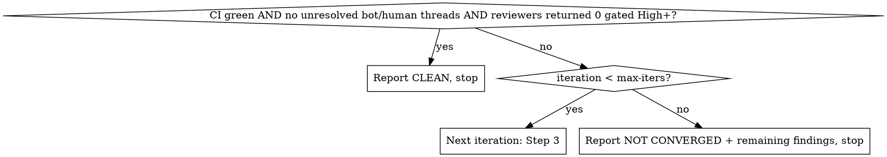

# Harden PR

Converge an existing PR to "no findings" by looping: **review (5 parallel reviewers) → synthesize → fix High/Medium → push → wait for CI + bots → repeat**. Each iteration is reported, including which findings no bot would have caught.

## When to use

- A PR exists (draft or open) and the goal is a hardened PR *before* a human reviewer spends time on it.
- After review feedback landed and the cycle should run again.
- NOT for a branch with no PR yet — use `ato-workflow:push-pr` first.
- NOT per-commit. One run = 5 reviewer agents + a fix pass + CI wait, per iteration.

Related: `ato-workflow:pre-pr-review` (broader 7-reviewer one-shot report, no fixing), `ato-workflow:pr-review-resolver` (answers and resolves *human/bot* threads). This skill is the closed loop with self-review as the driver.

## User Input

```text
$ARGUMENTS
```

Accepted: a PR number (else the current branch's PR), `--max-iters N` (default 3),
`--no-push` (review + fix locally, never push), `--only <roles>`, `--base <branch>`.

## Environment constraints (Windows dev box)

- `jq` is **NOT installed**. Use `gh`'s built-in `--jq` / `-q` only; never pipe to `jq`.
- Never edit files via heredoc / `sed` / `cat >`. Use Edit/Write.
- Never `git add -A` — untracked non-gitignored secret files exist in these repos. Stage explicit paths.
- Never `--force` push. Never rebase a pushed branch inside this loop.

---

## Step 1 — Preflight and worktree

```bash
PR=${ARG_PR:-$(gh pr view --json number -q '.number')}
REPO=$(gh repo view --json nameWithOwner -q '.nameWithOwner')
HEAD_BRANCH=$(gh pr view "$PR" --json headRefName -q '.headRefName')
BASE_BRANCH=$(gh pr view "$PR" --json baseRefName -q '.baseRefName')
JIRA=$(echo "$HEAD_BRANCH" | grep -oE '^ATO-[0-9]+' || true)
```

Abort if `$PR` is empty. If `$JIRA` is empty, say so — fix commits will carry no JIRA prefix and the spec-conformance role has no ticket to compare against.

Isolate, so the user's working tree is never touched:

```bash
WT_DIR=".claude/worktrees/harden-pr-$PR"
git worktree add "$WT_DIR" "$HEAD_BRANCH" 2>/dev/null || true
cd "$WT_DIR" && git fetch --quiet origin && git pull --ff-only
mkdir -p .claude/review
```

Findings files live at `.claude/review/<role>.md` **inside the worktree**. Confirm `.claude/` is ignored (`git check-ignore -q .claude` ); if it is not, still write them but **never stage them** — list the exact paths you stage in every commit.

---

## Step 2 — Shared context block

Build once; every reviewer gets the identical block so findings are comparable.

```
PR: #<PR> in <REPO>          Branch: <HEAD_BRANCH>   Base: origin/<BASE_BRANCH>
Diff: git diff origin/<BASE_BRANCH>...HEAD
Ticket: <JIRA or GitHub issue link, or "none">

Read the diff yourself. Do NOT modify files. Do NOT post anything to GitHub.
Write your findings to .claude/review/<role>.md AND return them in your response.

Severity rubric — use THIS scale, judged by production blast radius, not by whether
the build is green (all of the below ship green):
- CRITICAL: destroys / leaks / corrupts data, breaks the hot path, cross-tenant or
  cross-shard exposure, unregistered CQRS handler (throws at runtime), unhandled
  exception on the normal path.
- HIGH: wrong behavior on a conditional / flag / secondary path; state that is set but
  never reset; a test that locks in the wrong behavior; silent scope drift.
- MEDIUM: maintainability, perf on common paths, N+1, duplicated logic, missing but
  non-critical test.
- LOW: style, naming, comments, cosmetics.

Every Critical/High finding MUST carry a concrete failure scenario (inputs / state ->
wrong output or crash) and a reproducing path:line. No scenario = drop the finding.
Tag each finding IN-DIFF (anchors to a + line) or ADJACENT (pre-existing code nearby).
Stay in your own scope; defer cross-domain notes in one line.
```

---

## Step 3 — Fan out 5 reviewers in parallel

One message, five Agent calls. Sequential launching defeats the purpose.

| Role | file | `subagent_type` | Owns |
|------|------|-----------------|------|
| correctness | `correctness.md` | `ato-agents:code-reviewer` | Counters, retry counts, flags/latches set but never reset on **every** branch; totals and aggregates; early-return paths that skip cleanup |
| flags | `flags.md` | `ato-agents:feature-flag-reviewer` | Enumerate **every** new/changed code path and the flag gating it; anything ungated is a finding, with the legacy `else` branch check |
| blast-radius | `blast-radius.md` | `ato-agents:sceptic-reviewer` | Retry storms, throttling, self-DOS, downstream/upstream load, poison messages, recovery gaps, 3 AM behavior |
| tests | `tests.md` | `ato-agents:test-coverage-reviewer` | Removed/weakened tests, missing happy/error/integration coverage for changed behavior, assertions contradicting their test name |
| spec | `spec.md` | `general-purpose` | Diff vs the linked ticket: unmet acceptance criteria, and diff content the ticket never asked for |

If an `ato-agents:*` type is unavailable, fall back to `general-purpose` with the same role text and say so in the report.

Role-specific additions to the shared block:

- **correctness**: "For each mutable piece of state the diff introduces or touches, list every write site and every reset site. A write with no reset on some reachable path is a HIGH finding."
- **flags**: "Output a table: code path | flag | gated? | legacy else-branch present?. Ungated paths are findings even if intentional — the author must justify or bundle."
- **spec**: fetch the ticket first — `mcp__spiris-jira__jira_issues_get` for `ATO-NNNNN`, or `gh issue view` — then diff against acceptance criteria. If no ticket, report `SKIPPED (no ticket)`.

---

## Step 4 — Synthesize (orchestrator only, no new agents)

1. **Partition**: IN-DIFF findings are gated; ADJACENT/pre-existing ones are reported but never block and never get auto-fixed.
2. **Cluster**: same root concern + same location (same symbol, or line ranges within ~5 lines) = one entry. Opposite conclusions about the same line are a **disagreement**, not a duplicate — surface both.
3. **Corroboration**: `N` = distinct roles in the cluster. `N >= 3` and at least one concrete `path:line` → raise one severity level (cap Critical). `N == 2` → float to top of its bucket.
4. **Rank** Critical → Low. Annotate each entry `[roles] (N/5)`.
5. **Verify before fixing**: for each gated Critical/High cluster, launch one fresh `ato-agents:sceptic-reviewer` in parallel with only the claim + location (never the original reasoning), default verdict REJECTED, flipped only on a reconstructed failure path. Drop the rejected ones.

Write the surviving list to `.claude/review/_synthesis-iter<N>.md`.

---

## Step 5 — Fix

Fix every surviving **High and Medium** (and Critical). Skip Low unless trivially safe and in the same file already being edited.

**Escalate to the user instead of fixing** when the fix touches auth, secrets, crypto, SQL schema/migrations, PII handling, or removes/loosens a feature flag. State the proposed change and wait.

Rules:
- Edit/Write only.
- New behavior stays behind the PR's feature flag; keep the legacy path in `else`.
- Add or repair the tests the `tests` role named — a fix with no test is not fixed.
- Build + run the relevant test suite in the worktree and **paste the real output**. Failing output gets reported as failing, never summarized away.
- Commit with explicit paths and a `<JIRA> ` prefixed message; one commit per iteration is fine.

---

## Step 6 — Push and wait for CI + bots

Skip entirely under `--no-push`.

```bash
git push origin "$HEAD_BRANCH"
gh pr checks "$PR" --watch --interval 30
```

If `--watch` is unavailable or the terminal cannot hold it, poll instead and **echo one status line every poll** (a silent watcher hides its own failure):

```bash
gh pr checks "$PR" -q '.[] | [.name,.state] | @tsv'   # gh's built-in jq — no jq binary needed
```

Cap any single wait at 20 minutes; on timeout report the last state per check rather than blocking.

Then collect bot/human feedback that arrived for this push:
- Blocking reviews: `gh pr view "$PR" --json reviews -q '.reviews[] | [.author.login,.state] | @tsv'`
- Unresolved threads: the GraphQL `reviewThreads` query from `ato-workflow:pr-review-resolver` Step 2, filtered to `isResolved == false` and `isOutdated == false`.
- If the auto-reviewer bot does not re-review a new push, read its login from the prior reviews and re-request it (`gh pr edit "$PR" --add-reviewer <login>`); if that fails, say so and continue rather than looping on it.

---

## Step 7 — Loop



Stop early — and say why — if an iteration produces **no net progress** (same clusters survive verification with nothing fixed), or if two consecutive iterations only surface Low findings. Never keep pushing to chase a red check whose cause is outside the diff (flaky infra, base branch broken): report it as external.

---

## Step 8 — Report

Per iteration, in the response — not only in files:

```
### Iteration <N>
Reviewer findings: C:<n> H:<n> M:<n> L:<n>  (verified survivors / raw)
| Sev | Finding | Roles (N/5) | path:line | Action |
Fixed: <list>   Escalated: <list>   Deferred (adjacent/Low): <list>
Build/tests: <pass|fail + the pasted output's decisive line>
CI: <check states>   Bots: <who reviewed, verdict, threads open>
Would have escaped: <findings no bot or CI check flagged this iteration>
```

Final block: iterations run, converged yes/no, total fixed, still-open items, and the worktree path (left in place for inspection; removal is the user's call — offer `git worktree remove`).

## Common mistakes

| Mistake | Consequence |
|---------|-------------|
| Launching reviewers sequentially | 5x wall clock for identical output |
| Piping `gh` output to `jq` | Fails silently on this box — `jq` is not installed |
| Trusting the first synthesis | Unverified self-review is noisy; the refute pass halves it |
| Auto-fixing ungated code by adding a flag on the author's behalf | Flag naming/tiering is a ticket-level decision — escalate |
| Reporting "CI green" from a `--watch` that exited early | Re-read the check states explicitly after the wait |
| `git add -A` in the worktree | Sweeps untracked secret files into the commit |
| Looping past `--max-iters` "because it's nearly clean" | Runaway cost; report NOT CONVERGED instead |

## Self-improvement

When an iteration's "Would have escaped" list contains a bug class that a **reviewer role prompt** should have caught, fix the role prompt in this file before the next run — and when a class recurs across PRs, push it down into the owning `ato-agents` reviewer or a deterministic hook (per `friction-to-skill`). The loop's job is to shrink itself: a finding caught twice by this skill and never by CI is a missing CI check, not a permanent reviewer duty.
