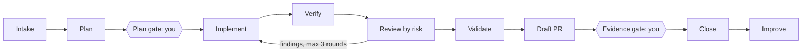

# Using jflow

What you type, what happens, and where you are asked. For the reasons behind the design and the build log, see [how-it-works.md](how-it-works.md). For installation, see the [README](../README.md).

## The short version

```text
/jflow PROJ-123                     implement a ticket, ends in a draft PR
/jflow investigate <question>       answer a question, ends in findings and ticket drafts
/jpeerreview                        review the PRs that request your review, ends in drafted comments
jplan ls                            what is open, and what each task waits for
```

You decide twice per task: at the plan and at the evidence. Everything between those two points runs without you, behind gates that are scripts and not instructions.

## How a task moves



The task status in the ledger follows the same path:

| Status | Meaning | Who moves it on |
|---|---|---|
| `todo` | Registered, nobody works on it | You, by starting `/jflow <key>` |
| `active` | A stage is running | The flow |
| `waiting` | A gate or a question; `next` says what is needed | You |
| `review` | Draft PR is open, or a posted review waits for replies | You and your reviewers |
| `done` | Merged and closed out | The flow, after merge |
| `dropped` | Abandoned | You |

`jplan ls` shows the status and the `next` line of every open task. That line is the answer to "what is left".

## Implement a ticket

```text
/jflow PROJ-123
```

1. **Intake.** The flow finds or creates the ledger task, prints a `Ledger:` line, loads the project profile, and for a Jira key writes the ticket's what, why and done criteria into `task.md`. A task that is unclear or is really two tasks stops here with a question.
2. **Plan.** A read-only planner (`j-the-problem-solver`, top-tier model) reads the code and writes `plan.md`: approach, files, tests, risks, rollout and feature flag. Where there is a real choice it gives a minimal and a robust option. Length is capped by difficulty: 600 words for a simple task, 1,500 by default, 4,000 for a hard one.
3. **Plan gate.** You get the approach in five lines, the options, the risks and what is not covered. Answer with approve, a choice between the options, or a change. Nothing is written to a repo before this.
4. **Implement.** The implementer (`j-the-implementer`, Sonnet) works in its own worktree and commits after each work item. A question the plan does not settle comes back to you; it is not guessed.
5. **Verify.** The profile's build, lint and test commands run, and the result goes to `evidence/verify-<sha>.md`. Review starts only on a commit with a passing verify file.
6. **Review.** The depth follows the risk:

   | Tier | When | Reviewers |
   |---|---|---|
   | light | under 100 changed lines, no sensitive path | code |
   | standard | everything else | code, test coverage, feature flag |
   | full | a sensitive path from the profile, or over 600 changed lines | standard plus security, architecture, sceptic |

   Only findings about behaviour, correctness, security, real test gaps and rollout are kept. Code-preference findings are dropped.
7. **Fix loop.** Fix, verify, re-review the changed parts. Three rounds at most; what is still open then goes to you as a list.
8. **Validate.** If the profile declares validation slots (a running stack the change can be exercised on), the flow takes a free one, exercises the change and saves the proof in `evidence/`.
9. **Draft PR.** Push, open a draft PR, status `review`.
10. **Evidence gate.** You get what changed, the verify result, the review tier and its findings, the validation proof, and what was not tested. Answer ready, more work, or drop.
11. **Close.** After merge the flow drafts the Jira summary (posted only after your yes), writes three lines to `learnings.md` and sets `done`.

Several tickets at once: `/jflow PROJ-1 PROJ-2 PROJ-3` plans all of them first and shows every plan at one gate.

## Investigate a question

```text
/jflow investigate why the pricing cache serves stale rows
```

No code changes. Read-only agents gather facts into `notes/`, each with its sources, and a decisive fact is checked by a second method. You get `findings.md` (the answer first, then the evidence, then what is unknown) and options with effort, risk and a recommendation. At the gate you choose; for the chosen items the flow writes ticket drafts that stand alone for a reader who was not there, and creates them in Jira after your yes. A ticket you want done now becomes a new implement task.

## Review a colleague's PR

```text
/jpeerreview                 every open PR that requests your review
/jpeerreview repo#1234       one PR, also when no review is requested
/jpeerreview from Caroline   your review inbox, filtered by author
/jpeerreview replies         answers to comments you posted earlier
```

The flow reads the PR in a detached worktree (no build, no edits), runs the project's reviewers at the tier the diff earns, adds `/code-review` and a personal lens, and then filters: no code-preference remarks, nothing a bot or a person already raised, nothing it could not confirm on the actual lines. The result is `review.md` with a verdict and at most seven comments, each written exactly as it would be posted.

Nothing is posted until you answer with the numbers to post, any edits, and the word `approve` or `comment`. A comment you delete or rewrite at the gate is recorded, and that record tunes the filter.

## The ledger

A task is a folder, not a chat. Any fresh session can continue from it.

```text
<planning root>/
  INDEX.md                 generated overview of every task
  IDEAS.md                 parked ideas
  _profiles/<project>.json repos, checks, reviewers, sensitive paths, validation slots
  _profiles/<project>.md   project notes: traps, what works (read at intake, extended at close)
  <project>/<key>/
    task.json              status, next, branch, PR, events
    task.md                what, why, done criteria
    plan.md                the approved plan and the decisions
    notes/                 facts gathered along the way
    evidence/              verify files and validation proof, named after the commit
    handoff.md             state for the next session, when one is needed
    scratch/               logs, videos, dumps; removed by jplan clean after close
```

```sh
jplan ls                                   # open tasks with status and next step
jplan show PROJ-123                        # one task in full
jplan new myproject PROJ-123 title="..." type=implement
jplan set PROJ-123 status=waiting next="approve plan"
jplan event PROJ-123 correction "plan missed the flag-off path"
jplan idea "numbered validation slots"     # park it, do not act on it
jplan stats                                # event classes across the last 20 tasks
jplan clean                                # sizes; add apply to remove scratch of closed tasks
jplan root                                 # where the planning root is on this machine
```

`jplan` takes about 25 ms per call, so it is cheap for an agent to keep the ledger current after every stage.

## Sessions and hand-off

- One task per session. A new task gets a new session.
- Above roughly 150K tokens of context, or when a task pauses for the day, the flow writes `handoff.md` (state, decisions, next step, open questions, paths). `/jflow <key>` in a fresh session reads it and continues from the recorded `next`.
- Every report starts with the `Ledger:` line, so a context summary cannot lose the task key.

## What stops and asks

| Situation | What happens |
|---|---|
| Plan gate, evidence gate, review comment pick | The flow stops; status `waiting`, `next` names the decision |
| A post to GitHub, Jira or Slack | The outbound hook asks before the call runs; the text was drafted to a file first |
| `git add -A`, `git add .` and their variants | Denied by the secret-file hook; paths are staged one by one |
| A check fails twice for the same reason | Stop and report, no third guess |
| Three fix rounds with open findings | Stop; the list goes to you |
| Usage gauge over 80% | Stop before the session limit does it |

## How the flow improves itself

After every close the flow runs `jplan stats`. A problem class (correction, review finding, rework, gate failure, budget) seen in three or more of the last 20 tasks is a pattern; a single bad task is not. For a pattern with a common cause it proposes one change to the generator, in this order of preference: a hook or script, then a skill or project profile, then a line in the project notes. You see the diff and the evidence, and nothing is applied without your yes. Each change is recorded in `_profiles/improvements.md`, and one that did not lower its count after ten more tasks is proposed for removal.

## A new project

A project needs no setup in advance. The first `/jflow` for it asks for the repos, the check commands and the Jira prefix, writes `_profiles/<project>.json`, and fills in missing facts as it learns them. Reviewers come from the profile; a project that names none gets the general `code-review` and `security-review`, never another project's reviewers.

## Models

| Role | Model |
|---|---|
| Planner | top tier, high effort |
| Implementer | Sonnet; an item that fails verify twice is rerun on Opus |
| Reviewers | Sonnet; security and architecture on Opus |
| Locating, relaying, formatting | Haiku |

Before a wave of three or more agents the flow reads the usage gauge and says the number. At most two top-tier agents run at once.
